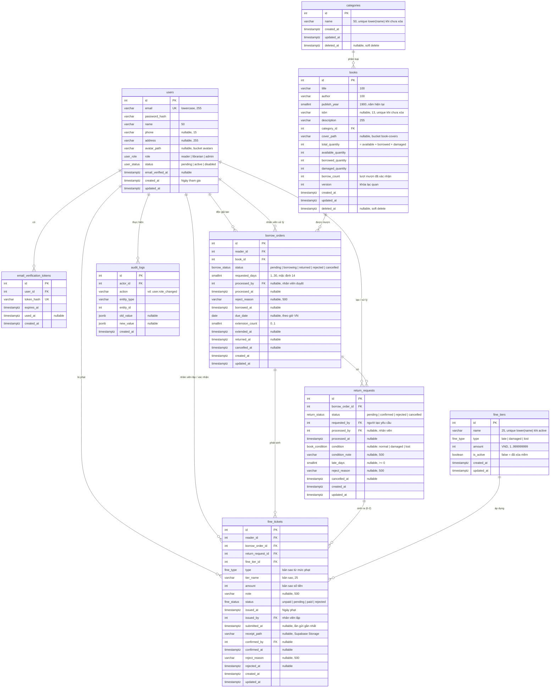

# ERD: Hệ thống quản lý thư viện mượn trả sách

Giai đoạn Design, bước 2/3. ERD này suy ra từ `design/flows/` và các quyết định đã chốt trong `design/flows/README.md` (2026-10-21). Đích triển khai: PostgreSQL trên Supabase, truy cập qua Prisma.

Quy ước: `[Giả định]` là quyết định tạm của người thiết kế ERD; `[Cần làm rõ]` cần người dùng chốt.

**Trạng thái: duyệt tạm ngày 2026-10-23, bao gồm mọi `[Giả định]`.** Lỗi phát hiện khi implement sẽ được sửa ở đây và ghi lại qua `/learn-by-mistake`.

## 1. Sơ đồ

## 2. Enum và nhãn hiển thị

Giá trị lưu trong DB bằng tiếng Anh (thuận tiện cho Prisma và code), UI ánh xạ sang nhãn tiếng Việt như PRD.

| Enum | Giá trị DB | Nhãn UI | Nguồn |
|------|-----------|---------|-------|
| `user_role` | `reader`, `librarian`, `admin` | Độc giả, Nhân viên, Quản lý viên | 2.6.2 |
| `user_status` | `pending`, `active`, `disabled` | Chờ xác nhận, Kích hoạt, Vô hiệu hóa | 2.1.1, 2.6.1 (README điểm 1) |
| `borrow_status` | `pending`, `borrowing`, `returned`, `rejected`, `cancelled` | Chờ xác nhận, Đang mượn, Đã trả, Bị từ chối, Đã hủy | 2.3.x (README điểm 4, 6) |
| (suy ra) | `borrowing` và ngày VN hiện tại > `due_date` | Quá hạn | 2.3.3, không lưu |
| `return_status` | `pending`, `confirmed`, `rejected`, `cancelled` | Chờ xác nhận, Đã xác nhận, Bị từ chối, Đã hủy | 2.4.x (README điểm 6) |
| `book_condition` | `normal`, `damaged`, `lost` | Bình thường, Hư hỏng, Mất | 2.4.2 |
| `fine_type` | `late`, `damaged`, `lost` | Trả muộn, Hư hỏng, Mất | 2.5.1 (README điểm 5) |
| `fine_status` | `unpaid`, `pending`, `paid`, `rejected` | Chưa thanh toán, Chờ xác nhận, Đã thanh toán, Từ chối | 2.5.2, 2.5.3 |

## 3. Từ điển dữ liệu và ràng buộc

Kiểu khóa chính: `integer GENERATED ALWAYS AS IDENTITY`. `[Giả định]` Dùng số nguyên thay UUID vì flow 2.2.4 coi id dạng số, và Prisma ánh xạ `Int` sang `number` của JS (BigInt gây khó khi trả JSON). Mọi thời điểm lưu `timestamptz` (UTC); ngày nghiệp vụ tính theo `Asia/Ho_Chi_Minh`.

### users
- `email` lưu dạng lowercase (chuẩn hóa ở backend) + `UNIQUE` (2.1.1 edge 1, 2).
- `status` mặc định `pending`; `role` mặc định `reader`, server không nhận `role` từ client khi đăng ký.
- Kích hoạt: qua link email (đặt `email_verified_at`, `status = active`) hoặc Admin bấm Kích hoạt ở 2.6.1.
- "Số lần mượn" và "Tổng tiền phạt" ở 2.1.3 tính bằng truy vấn, không lưu cột.
- `avatar_path`: đường dẫn trong bucket `avatars` (vd `<uuid>.webp`), null là chưa có ảnh (bổ sung 2026-10-22, xem mục 5 "Storage").
- Ràng buộc "luôn còn ít nhất một Admin active" kiểm tra trong transaction ở backend (2.6.1, 2.6.2), không đặt ở DB.

### email_verification_tokens
- Chỉ lưu hash của token. Token dùng một lần (`used_at`), có hạn (`expires_at`, `[Giả định]` 24h).
- `ON DELETE CASCADE` theo user.

### categories
- `UNIQUE (lower(name)) WHERE deleted_at IS NULL` (2.2.1 edge 1).
- `[Giả định]` Xóa thể loại là **soft delete**: điều kiện "không có sách nào thuộc thể loại" chỉ xét sách chưa xóa. Lý do: sách đã xóa mềm vẫn tham chiếu thể loại nên xóa cứng sẽ vi phạm khóa ngoại, và báo cáo cũ vẫn cần tên thể loại.
- `books.category_id` → `categories.id` `ON DELETE RESTRICT`.

### books
- `CHECK publish_year >= 1900`; giới hạn trên (năm hiện tại) kiểm tra ở Joi vì `CHECK` không nên phụ thuộc thời gian.
- `isbn` lưu dạng đã chuẩn hóa (bỏ gạch ngang, `X` hoa); `UNIQUE (isbn) WHERE isbn IS NOT NULL AND deleted_at IS NULL`.
- Bộ đếm kho (README điểm 3):
  - `CHECK available_quantity >= 0 AND borrowed_quantity >= 0 AND damaged_quantity >= 0`
  - `CHECK total_quantity = available_quantity + borrowed_quantity + damaged_quantity`
  - Thêm mới: `total = available = số lượng nhập`, các bộ đếm khác = 0.
  - Sửa số lượng tổng (2.2.5): `available = total_mới - borrowed - damaged`, chặn nếu kết quả < 0.
- `borrow_count` tăng 1 khi nhân viên xác nhận đơn mượn; dùng cho sắp xếp "phổ biến nhất" (2.2.3) và Top 5 (2.7.1) mà không phải đếm lại khi phân trang. `[Giả định]`
- `version` tăng mỗi lần sửa, dùng cho khóa lạc quan (2.2.5 edge 5).
- `cover_path`: đường dẫn trong bucket `book-covers`, null là chưa có ảnh (bổ sung 2026-10-22). Soft delete sách không xóa ảnh.
- Soft delete bằng `deleted_at` (README điểm 2). Danh sách và chi tiết công khai lọc `deleted_at IS NULL`.

### borrow_orders
- `CHECK requested_days BETWEEN 1 AND 30`, mặc định 14.
- `CHECK extension_count BETWEEN 0 AND 1`.
- `CHECK (status <> 'rejected' OR reject_reason IS NOT NULL)`.
- `CHECK (status NOT IN ('borrowing','returned') OR (borrowed_at IS NOT NULL AND due_date IS NOT NULL))`.
- `UNIQUE (reader_id, book_id) WHERE status IN ('pending','borrowing')`: một độc giả không thể có hai đơn hoạt động cho cùng một sách (2.3.1).
- `due_date` là ngày cuối cùng được trả (tính theo giờ VN) = ngày xác nhận + `requested_days`; gia hạn cộng 7 ngày. Quá hạn khi ngày VN hiện tại > `due_date`. `[Giả định]` dùng `date` thay `timestamptz` vì PRD tính hạn theo ngày.
- Giới hạn 5 cuốn (đếm `pending` + `borrowing`) và chặn khi có phiếu phạt chưa `paid` hoặc có đơn quá hạn (README điểm 8) kiểm tra trong transaction ở backend, khóa theo `reader_id`.
- Index: `(status, created_at)` cho danh sách chờ duyệt; `(reader_id, status)` cho lịch sử; `(book_id, status)` cho lịch sử theo sách và chặn xóa sách; `(status, due_date)` cho danh sách quá hạn.
- FK `reader_id`, `book_id`, `processed_by` đều `ON DELETE RESTRICT` (không xóa cứng user và sách).

### return_requests
- `UNIQUE (borrow_order_id) WHERE status = 'pending'`: tối đa một yêu cầu chờ trên mỗi đơn (2.4.1).
- `UNIQUE (borrow_order_id) WHERE status = 'confirmed'`: mỗi đơn chỉ được trả một lần.
- `CHECK (status <> 'confirmed' OR condition IS NOT NULL)`.
- `CHECK (condition NOT IN ('damaged','lost') OR condition_note IS NOT NULL)`.
- `CHECK (status <> 'rejected' OR reject_reason IS NOT NULL)`.
- Kết quả trả sách (tình trạng, ghi chú, số ngày muộn) nằm trên yêu cầu trả đã xác nhận. Dashboard "Bị mất / Hư hỏng" (2.7.1) và báo cáo sách cần thay thế (2.7.2) đếm từ đây.
- Tác động kho khi xác nhận (một transaction cùng đổi trạng thái đơn và tạo phiếu phạt):

| Tình trạng | available | borrowed | damaged | total |
|-----------|-----------|----------|---------|-------|
| `normal` | +1 | -1 | 0 | 0 |
| `damaged` | 0 | -1 | +1 | 0 |
| `lost` | 0 | -1 | 0 | -1 |

### fine_tiers
- `CHECK amount BETWEEN 1 AND 999999999` (số nguyên VND).
- `UNIQUE (lower(name)) WHERE is_active`.
- Không có cột "Ngày phạt" (README điểm 5); ngày phạt nằm ở `fine_tickets.issued_at`.
- Xóa: nếu chưa phiếu phạt nào dùng thì xóa cứng; nếu đã dùng thì `is_active = false` (2.5.1). FK từ `fine_tickets` `ON DELETE RESTRICT` là chốt chặn.
- Ở 2.4.2, danh sách chọn lọc theo `type` và `is_active`.

### fine_tickets
- Lưu bản sao `type`, `tier_name`, `amount` tại thời điểm lập, nên sửa hoặc ẩn mức phạt không ảnh hưởng phiếu cũ.
- `CHECK amount > 0`.
- `UNIQUE (return_request_id, type)`: một lần trả sinh tối đa một phiếu trả muộn và một phiếu hư hỏng hoặc mất.
- `CHECK (status <> 'rejected' OR reject_reason IS NOT NULL)`.
- Trả muộn áp dụng cho cả `normal`, `damaged` và `lost` (README điểm 9); số tiền là một mức phạt cố định nhân viên chọn, không nhân theo số ngày.
- `reader_id` lặp lại từ đơn mượn để truy vấn "phiếu của tôi" và "độc giả còn nợ phạt" không cần join.
- `receipt_path`: đường dẫn ảnh biên lai trong Supabase Storage, tùy chọn (README điểm 7). Gửi lại sau khi bị từ chối sẽ ghi đè `submitted_at`, `receipt_path`; `reject_reason` của lần trước được giữ cho tới khi có kết quả mới. `[Giả định]` Không lưu lịch sử từng lần gửi; lịch sử nằm ở `audit_logs` nếu cần.
- Index: `(reader_id, status)`, `(status, submitted_at)`, `(issued_at)` cho báo cáo phạt.

### audit_logs
- Ghi các thao tác quản trị: đổi vai trò (2.6.2 yêu cầu "ghi log người thực hiện"), kích hoạt hoặc vô hiệu hóa tài khoản, xác nhận hoặc từ chối phiếu phạt. `[Giả định]` một bảng chung thay vì bảng riêng cho từng loại.
- Index: `(entity_type, entity_id)`, `(actor_id, created_at)`.

## 4. Đối chiếu với các quyết định đã chốt

| README | Quyết định | Thể hiện trong ERD |
|--------|-----------|-------------------|
| 1 | Xác nhận qua email, Admin vẫn kích hoạt thủ công | `user_status`, `email_verified_at`, bảng `email_verification_tokens` |
| 2 | Soft delete sách và mức phạt đã dùng | `books.deleted_at`, `fine_tiers.is_active` (và `categories.deleted_at`, xem trên) |
| 3 | Bộ đếm kho; sách hư không quay lại `available` | 4 cột đếm trên `books` + `CHECK` tổng |
| 4 | Thống nhất trạng thái đơn, `Quá hạn` suy ra | `borrow_status`, `due_date` |
| 5 | Bỏ ngày phạt khỏi mức phạt, thêm loại, phiếu lưu bản sao số tiền | `fine_tiers.type`, `fine_tickets.amount/tier_name/type/issued_at` |
| 6 | Hủy đơn mượn chờ; từ chối và hủy yêu cầu trả | `borrow_status.cancelled`, `return_status.rejected/cancelled` |
| 7 | Ảnh biên lai tùy chọn | `fine_tickets.receipt_path` |
| 8 | Chặn mượn khi có sách quá hạn | Kiểm tra ở backend, dùng index `(status, due_date)` |
| 9 | Mất cũng có thể kèm phí muộn, mức cố định | `UNIQUE (return_request_id, type)` cho phép 2 phiếu với mọi tình trạng |
| 10 | Có làm trả tại quầy | Nhân viên tạo `return_requests` (`requested_by` = nhân viên) và xác nhận trong cùng transaction |

## 5. Ghi chú triển khai

- Prisma schema không biểu diễn được partial unique index, unique theo `lower(name)` và `CHECK`. Viết migration bằng SQL (áp qua Supabase MCP `apply_migration`), sau đó `prisma db pull` để sinh model; các ràng buộc trên vẫn tồn tại trong DB.
- Supabase mở schema `public` qua PostgREST. Backend truy cập bằng Prisma qua kết nối trực tiếp, nên bật RLS trên mọi bảng và không tạo policy nào cho `anon`/`authenticated`, tránh lộ dữ liệu qua API tự sinh. `[Giả định]`
- Không dùng Supabase Auth; xác thực bằng JWT tự quản như PRD.
- Tìm kiếm không dấu (2.2.3 edge 3): bật extension `unaccent` và tạo index biểu thức trên `title`, `author` nếu cần hiệu năng.
- `updated_at` cập nhật bằng Prisma `@updatedAt` hoặc trigger.
- **Storage** (bổ sung 2026-10-22, quy tắc ở `design/flows/README.md` mục "Upload file"): 3 bucket `avatars` (public), `book-covers` (public), `receipts` (private); giới hạn 2 MB và `image/jpeg`, `image/png`, `image/webp` đặt cả ở cấu hình bucket lẫn ở server. Các cột `*_path` lưu đường dẫn trong bucket, API ghép thành URL công khai (hoặc signed URL cho `receipts`) khi trả về. Tạo bucket cùng lúc migrate schema.

## 6. Điểm đã chốt (2026-10-23)

- README điểm 10: **có** làm trả tại quầy. Nhân viên tạo `return_requests` với `requested_by` là chính họ và xác nhận ngay trong cùng transaction; không đổi cấu trúc.
- Sách hư hỏng **không** quay lại kho: `damaged_quantity` chỉ tăng, không có thao tác `damaged` → `available`.
