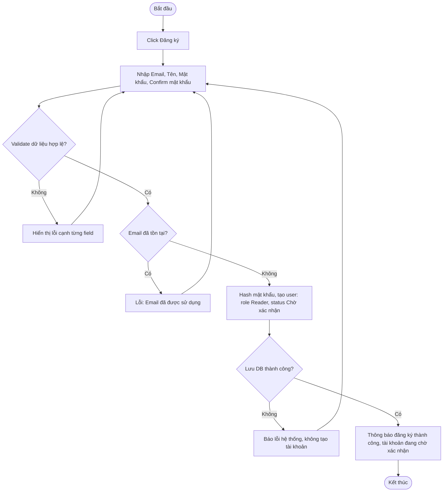

# 2.1.1 Đăng Ký

- **Actor:** Mọi người (chưa đăng nhập)
- **Tiền điều kiện:** Không có
- **Hậu điều kiện:** Có user mới, vai trò Reader, trạng thái `Chờ xác nhận`

## Flow

## Edge cases

| # | Tình huống | Xử lý |
|---|-----------|-------|
| 1 | Email trùng nhưng khác hoa/thường | Chuẩn hóa email về lowercase trước khi kiểm tra và lưu |
| 2 | Hai request đăng ký cùng email gửi đồng thời | Ràng buộc UNIQUE ở DB là chốt chặn cuối; request thua trả lỗi "Email đã được sử dụng" |
| 3 | Mật khẩu 7 hoặc 17 ký tự | Từ chối (cho phép 8-16) |
| 4 | Confirm mật khẩu không khớp | Lỗi tại field confirm, không gọi API |
| 5 | Tên chỉ chứa khoảng trắng | Trim rồi coi là rỗng, từ chối |
| 6 | Người dùng bấm Đăng ký nhiều lần liên tiếp | Vô hiệu hóa nút khi đang gửi; phía server vẫn chặn bằng UNIQUE |
| 7 | Client gửi thêm field `role` | Server bỏ qua, luôn gán Reader |

## Điểm cần làm rõ

- `[Cần làm rõ]` PRD nói trạng thái "Chờ xác nhận" nhưng không nói **ai/cách nào xác nhận** (link xác thực email hay Admin duyệt?). Giả định tạm: xác nhận qua email; Admin vẫn có thể kích hoạt thủ công ở 2.6.1.
- `[Giả định]` Trường Tên giữ nguyên Unicode (tiếng Việt có dấu).
