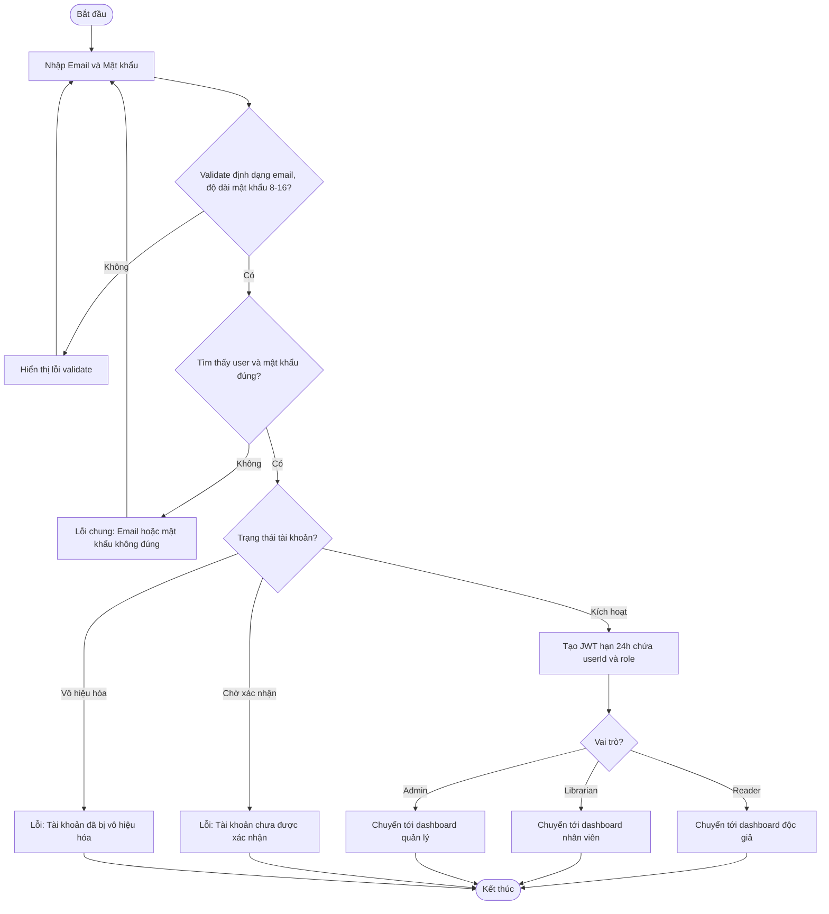
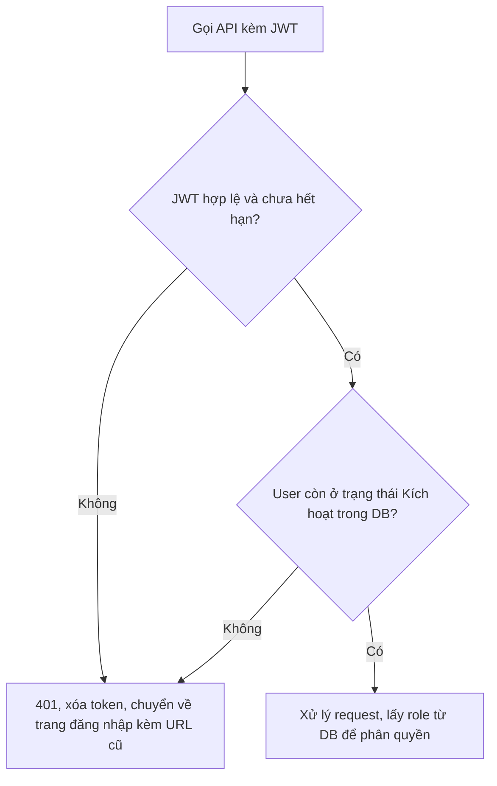

# 2.1.2 Đăng Nhập

- **Actor:** Mọi người
- **Tiền điều kiện:** Đã có tài khoản (2.1.1)
- **Hậu điều kiện:** Có JWT hợp lệ 24h, người dùng ở dashboard theo vai trò

## Flow

## Phiên hết hạn (sau khi đăng nhập)

## Edge cases

| # | Tình huống | Xử lý |
|---|-----------|-------|
| 1 | Email không tồn tại và mật khẩu sai | Cùng một thông báo chung, tránh lộ email nào đã đăng ký |
| 2 | Nhập sai liên tiếp nhiều lần | `[Giả định]` Rate limit theo IP và email (ví dụ 5 lần/15 phút), trả 429 |
| 3 | Tài khoản bị vô hiệu hóa khi JWT còn hạn | Middleware kiểm tra status trong DB mỗi request, trả 401/403 |
| 4 | Admin đổi vai trò khi JWT còn hạn | Phân quyền dựa vào role trong DB, không tin role trong token |
| 5 | JWT hết hạn khi đang thao tác form | Chuyển về đăng nhập, sau đó quay lại URL cũ |
| 6 | Đã đăng nhập mà vào lại trang đăng nhập | Chuyển thẳng tới dashboard theo vai trò |

## Điểm cần làm rõ

- `[Cần làm rõ]` PRD chỉ nói chuyển hướng tới dashboard của độc giả hoặc nhân viên; Admin chưa được nhắc. Giả định Admin có dashboard riêng (2.7.1).
- `[Cần làm rõ]` Phân biệt thông báo giữa "Chờ xác nhận" và sai mật khẩu có thể lộ việc email tồn tại; chỉ hiển thị sau khi mật khẩu đã đúng (như flow trên).
