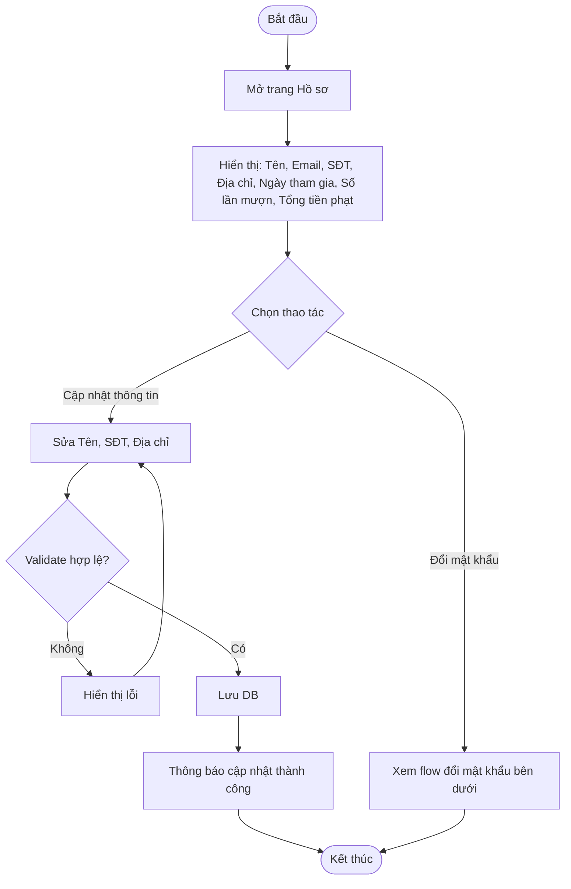
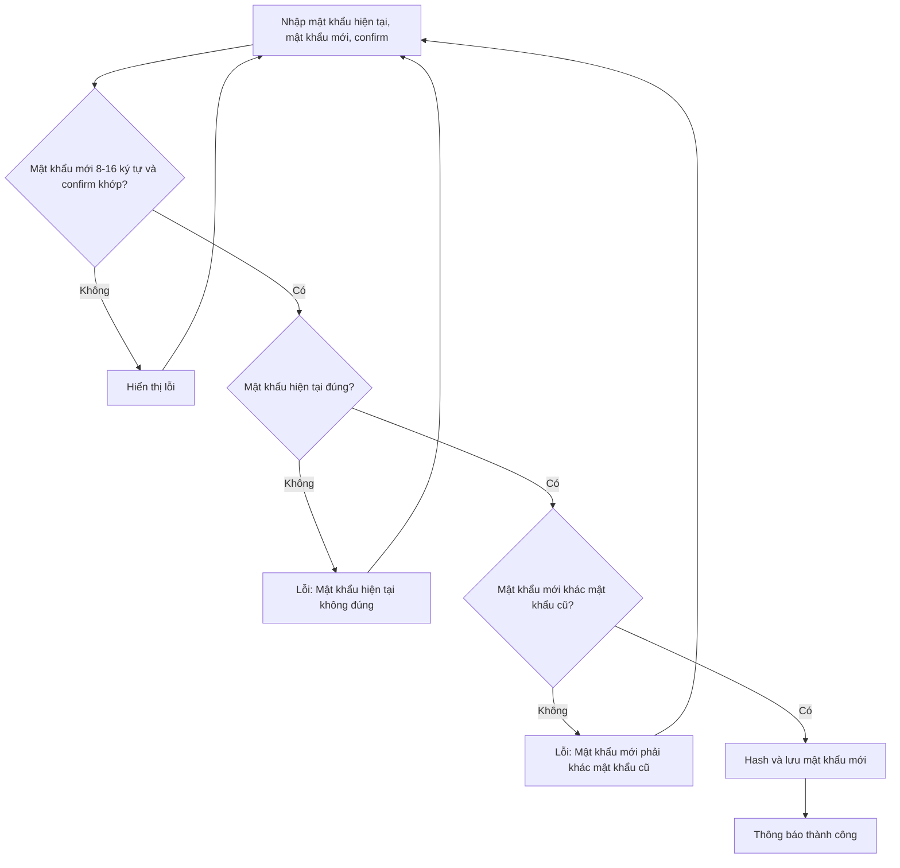

# 2.1.3 Hồ Sơ Cá Nhân

- **Actor:** Độc giả
- **Tiền điều kiện:** Đã đăng nhập với vai trò Reader
- **Hậu điều kiện:** Thông tin hoặc mật khẩu được cập nhật

## Flow xem và cập nhật thông tin

## Flow đổi mật khẩu

## Edge cases

| # | Tình huống | Xử lý |
|---|-----------|-------|
| 1 | Reader chưa có SĐT/Địa chỉ (đăng ký chỉ nhập Email, Tên, Mật khẩu) | Hiển thị trống; PRD bắt buộc Địa chỉ không rỗng nên chỉ validate khi người dùng bấm Lưu |
| 2 | SĐT sai định dạng | Lỗi tại field; `[Giả định]` chấp nhận số VN 10 số bắt đầu bằng 0 hoặc +84 |
| 3 | Địa chỉ quá 255 ký tự | Từ chối |
| 4 | Người dùng cố sửa Email | Email không cho sửa (PRD không liệt kê); server bỏ qua field này |
| 5 | Tổng tiền phạt | Tính từ các phiếu phạt (2.5), không lưu cứng ở user |
| 6 | Đổi mật khẩu thành công | `[Giả định]` Giữ phiên hiện tại; các token cũ không bị thu hồi vì JWT stateless (hạn 24h) |
| 7 | Vai trò Librarian/Admin mở trang này | PRD chỉ mô tả cho Độc giả; `[Cần làm rõ]` nhân viên và admin có hồ sơ riêng không |

## Điểm cần làm rõ

- `[Cần làm rõ]` PRD không yêu cầu nhập mật khẩu hiện tại khi đổi mật khẩu; flow này thêm bước đó vì lý do bảo mật.
- `[Cần làm rõ]` "Số lần mượn" tính theo đơn đã được xác nhận hay mọi đơn. Giả định: đơn đã được xác nhận mượn.
