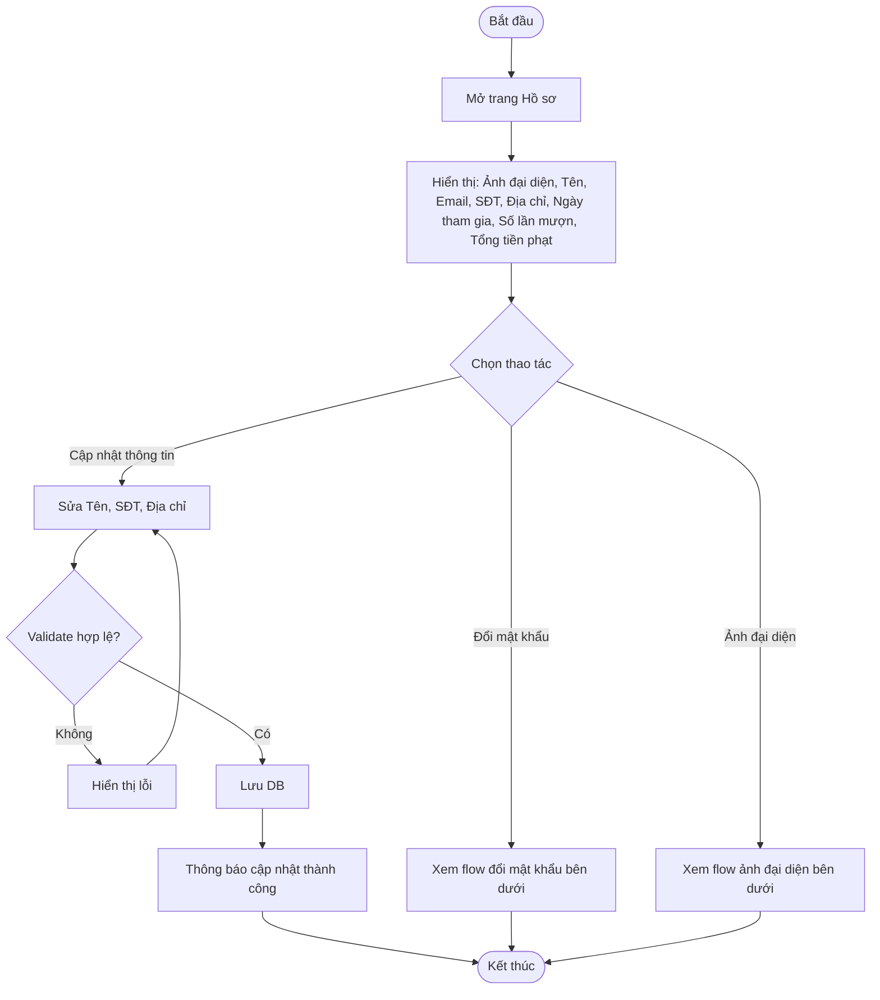
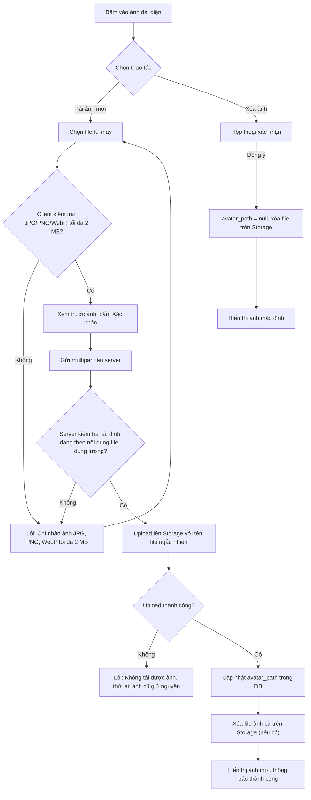
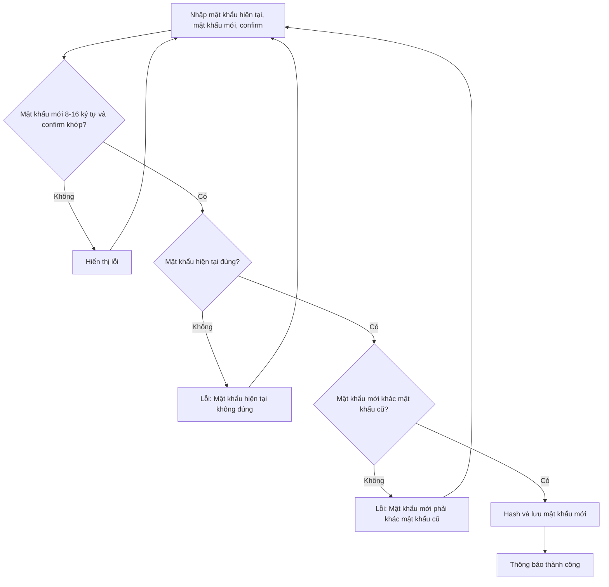

# 2.1.3 Hồ Sơ Cá Nhân

- **Actor:** Độc giả
- **Tiền điều kiện:** Đã đăng nhập với vai trò Reader
- **Hậu điều kiện:** Thông tin hoặc mật khẩu được cập nhật

## Flow xem và cập nhật thông tin

## Flow ảnh đại diện (bổ sung 2026-10-22)

Tải ảnh là thao tác riêng, không đi chung nút Lưu thông tin: chọn ảnh xong thì gửi ngay. Quy tắc chung về upload xem `README.md` mục "Upload file".

## Flow đổi mật khẩu

## Edge cases

| # | Tình huống | Xử lý |
|---|-----------|-------|
| 1 | Reader chưa có SĐT/Địa chỉ (đăng ký chỉ nhập Email, Tên, Mật khẩu) | Hiển thị trống; PRD bắt buộc Địa chỉ không rỗng nên chỉ validate khi người dùng bấm Lưu |
| 2 | SĐT sai định dạng | Lỗi tại field; `[Giả định]` chấp nhận số VN 10 số bắt đầu bằng 0 hoặc +84 |
| 3 | Địa chỉ quá 255 ký tự | Từ chối |
| 4 | Người dùng cố sửa Email | Email không cho sửa (PRD không liệt kê); server bỏ qua field này |
| 5 | Tổng tiền phạt | Tính từ các phiếu phạt (2.5), không lưu cứng ở user |
| 6 | Đổi mật khẩu thành công | `[Giả định]` Giữ phiên hiện tại; các token cũ không bị thu hồi vì JWT stateless (hạn 24h) |
| 7 | Vai trò Librarian/Admin mở trang này | PRD chỉ mô tả cho Độc giả; `[Cần làm rõ]` nhân viên và admin có hồ sơ riêng không |
| 8 | File đổi đuôi (vd `.exe` đổi thành `.jpg`) | Server kiểm tra magic bytes, không tin đuôi file hay `Content-Type` client gửi; từ chối 400 |
| 9 | File quá 2 MB | Client chặn trước; server giới hạn ở multer, trả 413 |
| 10 | Ảnh rất lớn về kích thước điểm ảnh, hoặc ảnh xoay sai | `[Giả định]` Không resize hay xử lý ảnh ở server; client hiển thị bằng CSS `object-fit: cover` khung vuông |
| 11 | Upload thành công nhưng cập nhật DB lỗi | Xóa file vừa upload để không để lại file mồ côi; ảnh cũ giữ nguyên |
| 12 | Xóa file cũ trên Storage thất bại | Không báo lỗi cho người dùng (DB đã đúng); ghi log để dọn sau |
| 13 | Hai lần tải ảnh liên tiếp | Vô hiệu hóa nút khi đang gửi; lần ghi DB sau cùng thắng, file của lần trước bị xóa theo bước M |

## Điểm cần làm rõ

- `[Giả định]` Ảnh đại diện chỉ hiển thị trong hồ sơ của chính độc giả và ở danh sách người dùng của Admin (2.6.1). PRD không nói nơi nào khác hiện ảnh này.

- `[Cần làm rõ]` PRD không yêu cầu nhập mật khẩu hiện tại khi đổi mật khẩu; flow này thêm bước đó vì lý do bảo mật.
- `[Cần làm rõ]` "Số lần mượn" tính theo đơn đã được xác nhận hay mọi đơn. Giả định: đơn đã được xác nhận mượn.

## Ghi chú khi implement (2026-10-23)

- `[Giả định]` "Tổng tiền phạt" là tổng mọi phiếu phạt của độc giả; trang hồ sơ hiện thêm dòng "Chưa thanh toán" (các phiếu chưa ở trạng thái Đã thanh toán).
- `[Giả định]` Đổi mật khẩu: sai mật khẩu hiện tại 5 lần / 15 phút thì trả 429, để token bị lộ không dò được mật khẩu.
- Edge 7 (còn cần làm rõ): API `/api/profile` hiện chỉ cho vai trò Reader, nhân viên và admin nhận 403; giao diện chuyển họ về dashboard của mình.
- Form thông tin và form đổi mật khẩu chỉ validate khi bấm nút (edge 1). Nếu validate khi rời ô, dòng lỗi hiện ra làm nút bị đẩy xuống và cú click trượt (E2E phát hiện).
