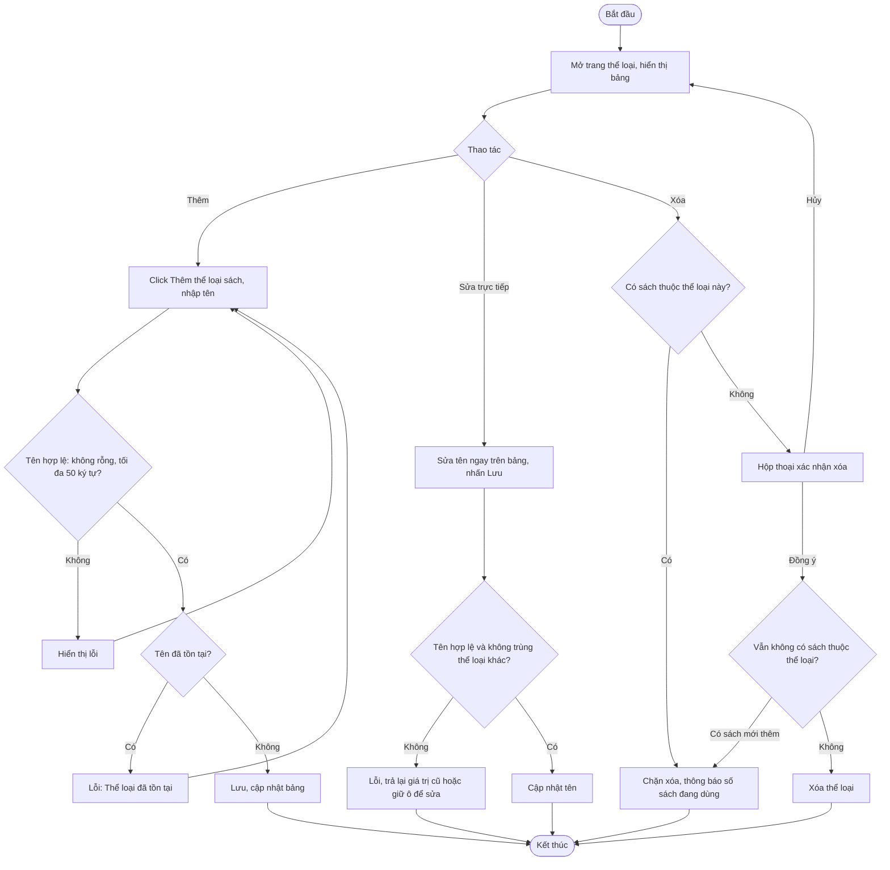

# 2.2.1 Quản Lý Thể Loại Sách

- **Actor:** Nhân viên thư viện (Admin cũng có toàn quyền)
- **Tiền điều kiện:** Đăng nhập vai trò Librarian
- **Hậu điều kiện:** Danh sách thể loại được thêm, sửa hoặc xóa

## Flow

## Edge cases

| # | Tình huống | Xử lý |
|---|-----------|-------|
| 1 | Tên trùng khác hoa/thường hoặc dư khoảng trắng | Trim và so sánh không phân biệt hoa thường |
| 2 | Hai nhân viên cùng xóa một thể loại | Lần sau nhận 404, tải lại bảng |
| 3 | Đang xác nhận xóa thì nhân viên khác thêm sách vào thể loại đó | Kiểm tra lại trong cùng transaction lúc xóa (FK RESTRICT là chốt chặn) |
| 4 | Sửa tên thể loại đang có sách | Cho phép; sách tham chiếu theo id nên không bị ảnh hưởng |
| 5 | Chưa có thể loại nào | Bảng trống kèm gợi ý thêm thể loại; 2.2.2 không thể thêm sách |
| 6 | Reader truy cập trang | 403 |
