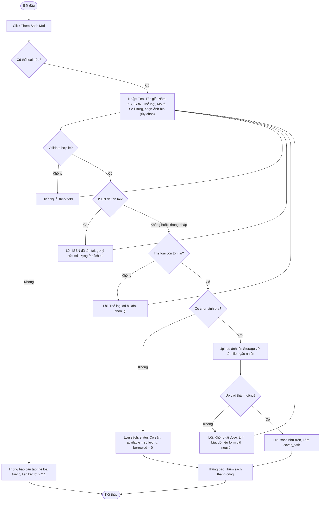

# 2.2.2 Thêm Sách Mới

- **Actor:** Nhân viên thư viện
- **Tiền điều kiện:** Đăng nhập vai trò Librarian; đã có ít nhất một thể loại (2.2.1)
- **Hậu điều kiện:** Sách mới trạng thái `Có sẵn`, số lượng có sẵn = số lượng nhập

## Flow

## Validation

| Field | Quy tắc |
|-------|---------|
| Tên sách | Bắt buộc, tối đa 100 ký tự |
| Tác giả | Bắt buộc, tối đa 100 ký tự |
| Năm xuất bản | Số nguyên từ 1900 đến năm hiện tại |
| ISBN | Tùy chọn; nếu có phải là ISBN-10 hoặc ISBN-13 hợp lệ (đúng checksum) |
| Thể loại | Bắt buộc, phải tồn tại |
| Mô tả | Bắt buộc, tối đa 255 ký tự |
| Số lượng | Số nguyên lớn hơn 0 |
| Ảnh bìa | Tùy chọn; JPG, PNG hoặc WebP (kiểm tra theo nội dung file ở server); tối đa 2 MB |

## Edge cases

| # | Tình huống | Xử lý |
|---|-----------|-------|
| 1 | ISBN có dấu gạch ngang hoặc khoảng trắng | Chuẩn hóa (bỏ ký tự phân tách) trước khi validate và lưu |
| 2 | ISBN-10 kết thúc bằng X | Chấp nhận chữ X hoa |
| 3 | Số lượng 0, âm, số thập phân, chữ | Từ chối |
| 4 | Năm xuất bản trong tương lai | Từ chối |
| 5 | Hai sách cùng tên và tác giả, không ISBN | Cho phép (có thể là hai ấn bản); `[Giả định]` chỉ cảnh báo, không chặn |
| 6 | Double submit | Vô hiệu hóa nút khi đang gửi; ISBN UNIQUE chặn trùng nếu có ISBN |
| 7 | Thể loại bị xóa giữa lúc điền form | Kiểm tra lại khi lưu (FK chặn) |
| 8 | Ảnh bìa sai định dạng hoặc quá 2 MB | Lỗi tại field ảnh, các field khác giữ nguyên (như 2.1.3 edge 8, 9) |
| 9 | Upload ảnh xong nhưng lưu sách lỗi (validate DB, ISBN trùng do race) | Xóa file vừa upload; server validate toàn bộ field trước khi upload để hạn chế trường hợp này |
| 10 | Không có ảnh bìa | Danh sách và chi tiết hiển thị ảnh mặc định |

## Điểm cần làm rõ

- `[Giả định]` "Số lượng bản sách" là bộ đếm trên đầu sách, không quản lý từng bản (mã vạch riêng). Mọi thống kê Hư hỏng/Mất ở 2.7 được suy ra từ phiếu trả và phiếu phạt.
- `[Giả định]` ISBN là duy nhất khi có giá trị.
