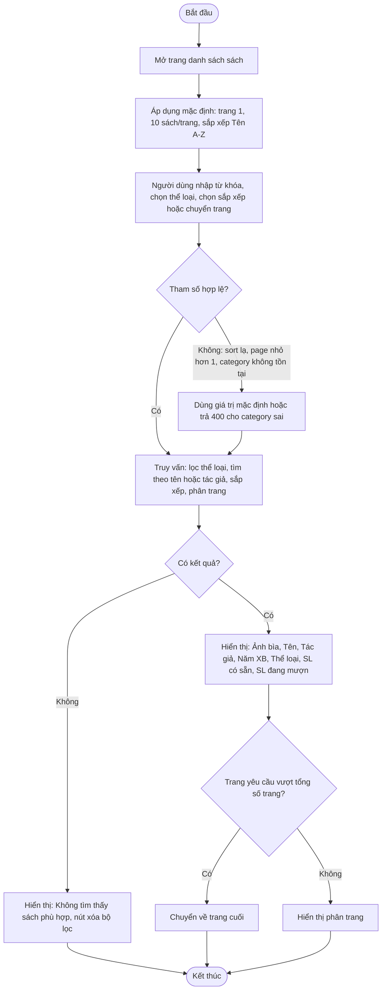

# 2.2.3 Xem Danh Sách Sách

- **Actor:** Tất cả người dùng, không cần đăng nhập
- **Hậu điều kiện:** Không thay đổi dữ liệu

## Flow

## Quy tắc

- Sắp xếp: `Tên (A-Z)`, `Năm xuất bản (mới nhất)`, `Lượt mượn (phổ biến nhất)`.
- Lượt mượn = tổng số đơn mượn đã được xác nhận của sách đó.
- Khi đổi từ khóa, thể loại hoặc sắp xếp thì quay về trang 1.
- Trạng thái lọc và trang nằm trên URL để chia sẻ và nút Back hoạt động.

## Edge cases

| # | Tình huống | Xử lý |
|---|-----------|-------|
| 1 | Thư viện chưa có sách | Trạng thái trống: "Chưa có sách nào" |
| 2 | Từ khóa chứa ký tự đặc biệt (`%`, `_`, `'`) | Dùng truy vấn tham số hóa của Prisma, escape ký tự wildcard của LIKE |
| 3 | Tìm tiếng Việt không dấu | `[Giả định]` Hỗ trợ tìm không phân biệt dấu (extension `unaccent`); nếu không, chỉ khớp theo dấu |
| 4 | Từ khóa chỉ gồm khoảng trắng | Coi như không có từ khóa |
| 5 | Sách hết (SL có sẵn = 0) | Vẫn hiển thị, đánh dấu "Hết sách" |
| 6 | Hai sách bằng nhau ở tiêu chí sắp xếp | Thêm tiêu chí phụ theo id để phân trang ổn định |
| 7 | Sách chưa có ảnh bìa, hoặc ảnh không tải được (file đã bị xóa) | Hiển thị ảnh mặc định (`onError` ở ``) |
| 8 | Tải 10 ảnh bìa mỗi trang | API trả URL công khai của ảnh; ``, khung cố định để bố cục không nhảy |

## Ghi chú triển khai (2026-10-24)

- API: `GET /api/books?q=&categoryId=&sort=name|newest|popular&page=` (công khai), trả `{ books, pagination: { page, pageSize, total, totalPages } }`. `page` trong response là trang thật sau khi chuyển về trang cuối.
- Edge 3: đã bật extension `unaccent` (migration `20261024000001_book_search_unaccent.sql`), tìm qua hàm `public.immutable_unaccent` với `ILIKE`.
- `[Giả định]` Bộ lọc thể loại lấy từ `GET /api/categories/options` (công khai, chỉ `id` + `name`); trang quản lý `GET /api/categories` vẫn chỉ cho nhân viên/Admin (2.2.1 edge 6).
- `[Giả định]` Từ khóa dài hơn 100 ký tự bị cắt, không báo lỗi. `categoryId` sai định dạng hoặc không tồn tại → 400 tại field `categoryId`; client hiện lỗi kèm nút "Xóa bộ lọc".
- `[Giả định]` Trang chủ `/` chuyển tới `/books`. Thẻ sách chưa liên kết tới trang chi tiết (thêm ở 2.2.4).
