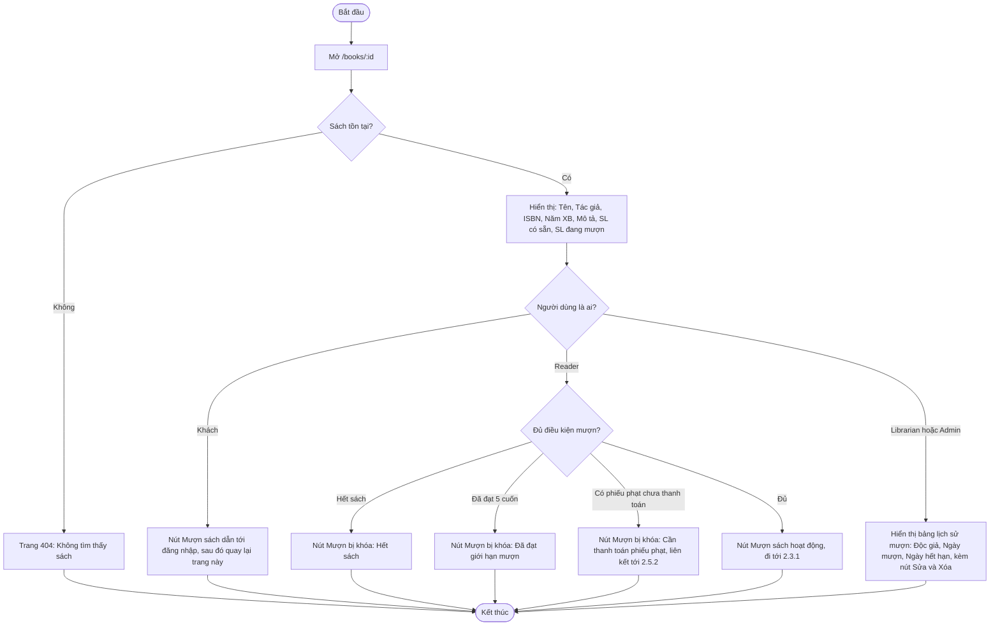

# 2.2.4 Xem Chi Tiết Sách

- **Actor:** Tất cả người dùng (không cần đăng nhập); Reader có thêm nút Mượn; Librarian thấy lịch sử mượn
- **Tiền điều kiện:** Sách tồn tại (2.2.3)

## Flow

## Edge cases

| # | Tình huống | Xử lý |
|---|-----------|-------|
| 1 | Id không hợp lệ (chữ, âm) | 404 như sách không tồn tại |
| 2 | Sách bị xóa trong lúc đang xem | Hành động tiếp theo (mượn) nhận 404 và thông báo rõ |
| 3 | Số liệu có sẵn thay đổi khi đang mở trang | Điều kiện được kiểm tra lại ở server khi mượn; UI chỉ là gợi ý |
| 4 | Khách xem lịch sử mượn | Không trả dữ liệu này từ API (không chỉ ẩn ở UI), vì có thông tin cá nhân |
| 5 | Sách chưa từng được mượn | Lịch sử hiển thị trống |
| 6 | Lịch sử mượn rất dài | Phân trang bảng lịch sử |
| 7 | Reader đã đang mượn hoặc chờ xác nhận chính sách này | `[Giả định]` Khóa nút kèm thông báo "Bạn đang mượn cuốn này" (xem 2.3.1) |

## Điểm cần làm rõ

- `[Cần làm rõ]` "Lịch sử mượn" có gồm đơn bị từ chối, đã trả hay chỉ đơn đang hoạt động. Giả định: tất cả đơn, kèm cột trạng thái.
