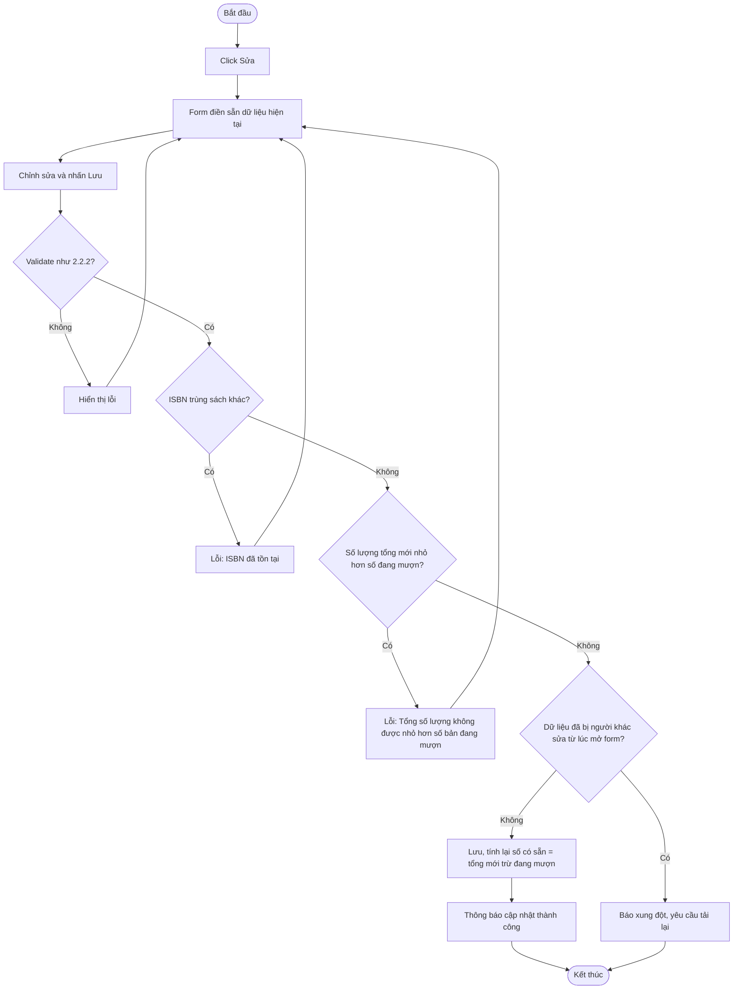
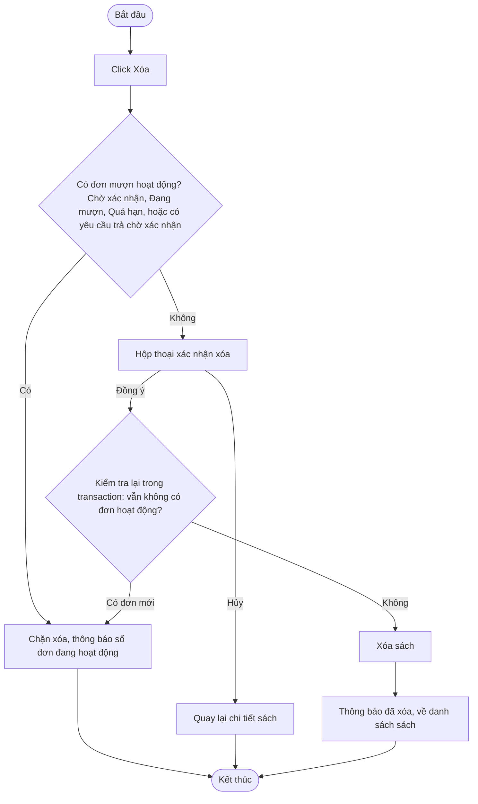

# 2.2.5 Sửa và Xóa Sách

- **Actor:** Nhân viên thư viện
- **Tiền điều kiện:** Đăng nhập vai trò Librarian; đang ở trang chi tiết sách (2.2.4)
- **Hậu điều kiện:** Sách được cập nhật hoặc bị xóa

## Flow sửa

## Flow xóa

## Edge cases

| # | Tình huống | Xử lý |
|---|-----------|-------|
| 1 | Sách có lịch sử mượn đã hoàn tất (đã trả, bị từ chối) | PRD cho xóa nếu không có đơn hoạt động. `[Giả định]` dùng soft delete (`deleted_at`) để giữ lịch sử và báo cáo, không xóa cứng |
| 2 | Giảm số lượng tổng xuống bằng đúng số đang mượn | Cho phép, số có sẵn về 0 |
| 3 | Đơn đang chờ xác nhận chưa trừ kho | Đơn chờ xác nhận vẫn được tính là đơn hoạt động nên chặn xóa |
| 4 | Đổi thể loại sang thể loại đã bị xóa | Kiểm tra tồn tại, FK chặn |
| 5 | Hai nhân viên sửa cùng lúc | Dùng khóa lạc quan (cột `updated_at` hoặc `version`) |
| 6 | Reader gọi API sửa hoặc xóa | 403 |

## Điểm cần làm rõ

- `[Cần làm rõ]` Soft delete hay xóa cứng (ảnh hưởng ERD). Đề xuất soft delete.
