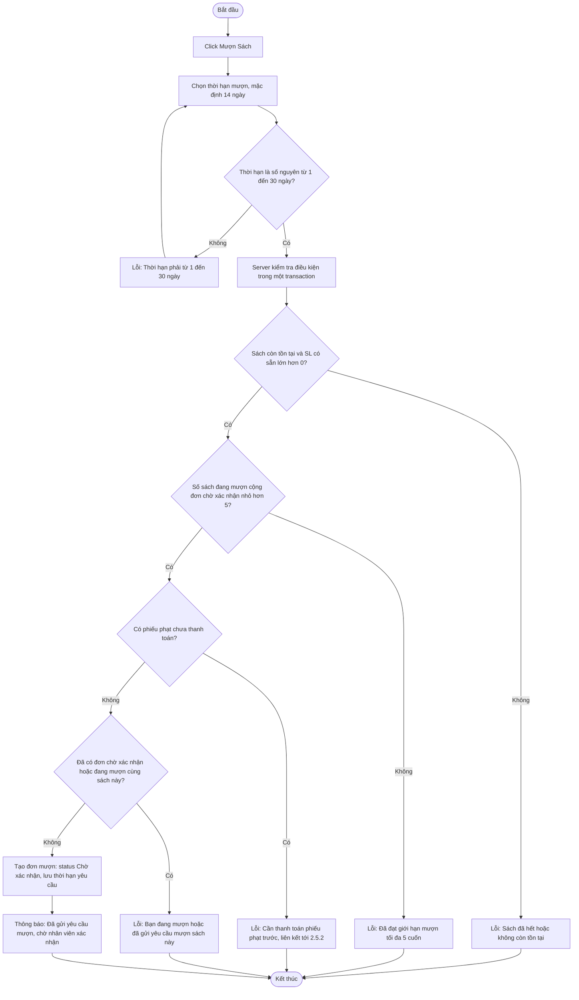

# 2.3.1 Mượn Sách (Độc Giả)

- **Actor:** Độc giả
- **Tiền điều kiện:** Đăng nhập vai trò Reader, tài khoản Kích hoạt; đang xem chi tiết sách (2.2.4)
- **Hậu điều kiện:** Có đơn mượn `Chờ xác nhận`. Kho **chưa** bị trừ, chỉ trừ khi nhân viên xác nhận (2.3.2)

## Flow

## Edge cases

| # | Tình huống | Xử lý |
|---|-----------|-------|
| 1 | Hai độc giả cùng gửi yêu cầu cho cuốn cuối cùng | Cả hai đơn được tạo vì kho chưa trừ; đơn xác nhận sau sẽ thất bại ở 2.3.2 (xem Cần làm rõ) |
| 2 | Số ngày 0, âm, 31+, số thập phân | Từ chối |
| 3 | Reader gửi nhiều yêu cầu nhanh để vượt giới hạn 5 | Đếm và tạo đơn trong cùng transaction với khóa theo user |
| 4 | Phiếu phạt trạng thái `Chờ xác nhận` hoặc `Từ chối` | Vẫn tính là chưa thanh toán xong, chặn mượn |
| 5 | Đơn trước đó của cùng sách đã `Đã trả` hoặc `Bị từ chối` | Cho phép mượn lại |
| 6 | Tài khoản bị vô hiệu hóa giữa chừng | Middleware từ chối (xem 2.1.2) |
| 7 | Reader có sách quá hạn nhưng chưa có phiếu phạt | `[Cần làm rõ]` PRD chỉ chặn theo phiếu phạt chưa thanh toán. Đề xuất chặn cả khi có sách đang quá hạn |

## Điểm cần làm rõ

- `[Cần làm rõ]` Đơn chờ xác nhận có tính vào giới hạn 5 cuốn không. Giả định: có, để tránh vượt giới hạn.
- `[Cần làm rõ]` Giữ chỗ: PRD trừ kho lúc xác nhận nên đơn chờ không giữ sách. Chấp nhận để nhân viên từ chối khi hết sách.
- `[Cần làm rõ]` Reader có tự hủy đơn đang `Chờ xác nhận` không, và đơn chờ quá lâu có tự hết hạn không. PRD không nói. Đề xuất bổ sung nút Hủy đơn.
  - Đã làm (2026-10-24): nút "Hủy yêu cầu mượn" trên trang chi tiết sách, hỏi xác nhận; chỉ hủy đơn của chính mình còn `Chờ xác nhận` (đã được xử lý → báo lỗi). Tự hết hạn đơn chờ: chưa làm, vẫn để ngỏ.
- Ngày hết hạn tính từ **ngày nhân viên xác nhận**, không phải ngày gửi yêu cầu.
