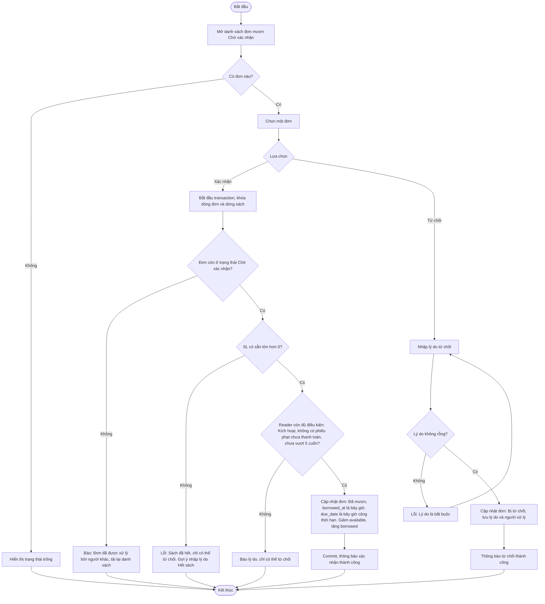

# 2.3.2 Mượn Sách (Nhân Viên Thư Viện): Xác Nhận và Từ Chối

- **Actor:** Nhân viên thư viện
- **Tiền điều kiện:** Đăng nhập vai trò Librarian; có đơn `Chờ xác nhận` (2.3.1)
- **Hậu điều kiện:** Đơn thành `Đã mượn` (kho giảm) hoặc `Bị từ chối` (kèm lý do)

## Flow

## Edge cases

| # | Tình huống | Xử lý |
|---|-----------|-------|
| 1 | Hai nhân viên cùng xử lý một đơn | Khóa dòng hoặc cập nhật có điều kiện `WHERE status = 'Chờ xác nhận'`; bên sau nhận thông báo đã xử lý |
| 2 | Kho về 0 giữa lúc gửi đơn và lúc xác nhận | Không cho xác nhận, đề xuất từ chối kèm lý do |
| 3 | Lý do từ chối chỉ chứa khoảng trắng hoặc quá dài | Trim rồi coi là rỗng; `[Giả định]` tối đa 500 ký tự |
| 4 | Giảm kho và đổi trạng thái đơn không đồng thời | Cả hai nằm trong một transaction, lỗi thì rollback toàn bộ |
| 5 | Sách bị xóa khi đơn còn chờ | Không xảy ra vì 2.2.5 chặn xóa sách có đơn hoạt động |
| 6 | Reader bị vô hiệu hóa | Chặn xác nhận, cho từ chối |
| 7 | Reader bị Admin đổi vai trò thành Librarian khi đơn đang chờ | Vẫn xử lý bình thường, đơn gắn với user |

## Điểm cần làm rõ

- `[Cần làm rõ]` Tên mục này là "Mượn sách (nhân viên)" nhưng flow thực chất là duyệt đơn. PRD không cho nhân viên tạo đơn mượn thay độc giả tại quầy. Giả định: không có.
- `[Cần làm rõ]` PRD dùng cả "Đã mượn" (2.3.2) và "Đang mượn" (2.3.3). Thống nhất dùng `Đang mượn` làm trạng thái duy nhất.
