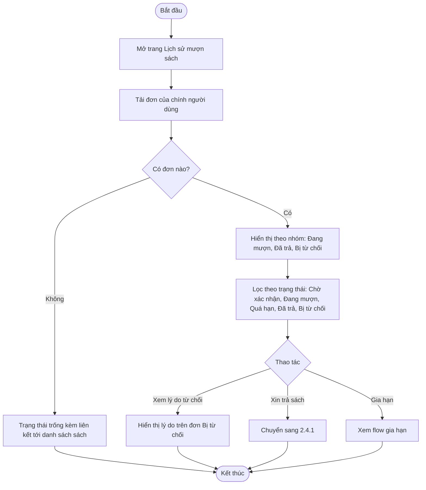
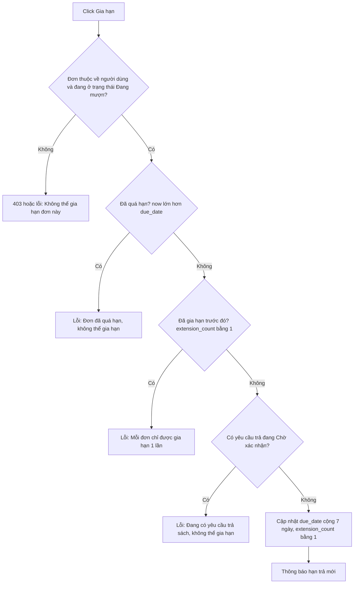

# 2.3.3 Xem Lịch Sử Mượn Sách và Gia Hạn

- **Actor:** Độc giả
- **Tiền điều kiện:** Đăng nhập vai trò Reader
- **Hậu điều kiện:** Chỉ xem; hoặc đơn được gia hạn thêm 7 ngày

## Flow xem lịch sử

## Flow gia hạn

## Quy tắc trạng thái hiển thị

| Trạng thái | Điều kiện |
|-----------|-----------|
| Chờ xác nhận | Đơn vừa gửi, chưa được nhân viên xử lý |
| Đang mượn | Đã xác nhận, hạn trả còn hiệu lực |
| Quá hạn | Đang mượn và hạn trả đã qua. `[Giả định]` suy ra khi truy vấn, không cần job cập nhật |
| Đã trả | Nhân viên đã xác nhận trả (kể cả hư hỏng hoặc mất) |
| Bị từ chối | Nhân viên từ chối, có lý do |

Số ngày còn lại = ngày hạn trả trừ ngày hiện tại (hiển thị âm hoặc "Quá n ngày" khi quá hạn).

## Edge cases

| # | Tình huống | Xử lý |
|---|-----------|-------|
| 1 | Người dùng cố xem đơn của người khác qua id | Luôn lọc theo `user_id` từ token; 404 nếu không phải của mình |
| 2 | Bấm Gia hạn hai lần nhanh | Cập nhật có điều kiện `extension_count = 0`; lần hai thất bại |
| 3 | Đơn hết hạn đúng lúc bấm Gia hạn | Server kiểm tra thời gian, từ chối |
| 4 | Múi giờ | Lưu UTC, tính hạn trả theo ngày theo múi giờ `Asia/Ho_Chi_Minh` `[Giả định]` |
| 5 | Có phiếu phạt chưa thanh toán | Vẫn được gia hạn, vì PRD chỉ chặn mượn mới `[Cần làm rõ]` |
| 6 | Nhiều đơn | Phân trang danh sách |
