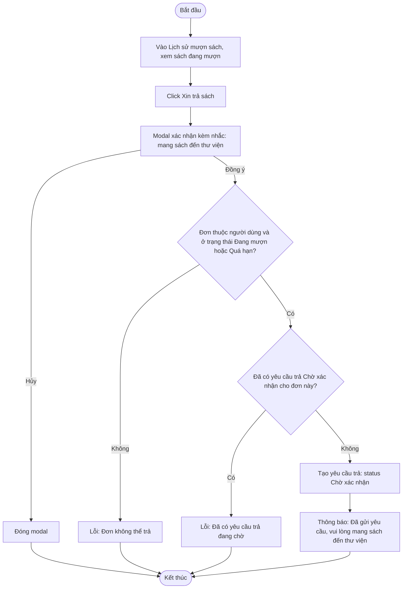

# 2.4.1 Yêu Cầu Trả Sách

- **Actor:** Độc giả
- **Tiền điều kiện:** Đăng nhập vai trò Reader; có đơn đang mượn (2.3.3)
- **Hậu điều kiện:** Có yêu cầu trả `Chờ xác nhận`; đơn mượn **không** đổi trạng thái cho đến khi nhân viên xác nhận (2.4.2)

## Flow

## Edge cases

| # | Tình huống | Xử lý |
|---|-----------|-------|
| 1 | Bấm gửi nhiều lần hoặc mở hai tab | Ràng buộc: tối đa một yêu cầu `Chờ xác nhận` trên mỗi đơn (partial unique index) |
| 2 | Đơn đã quá hạn | Vẫn được tạo yêu cầu trả; phí trả muộn xử lý ở 2.4.2 |
| 3 | Đơn đã `Đã trả` do nhân viên xử lý ở quầy | Từ chối tạo yêu cầu |
| 4 | Độc giả không đến thư viện | Yêu cầu giữ nguyên `Chờ xác nhận`; đơn vẫn đếm quá hạn theo ngày |
| 5 | Độc giả muốn hủy yêu cầu trả | `[Cần làm rõ]` PRD không nói; đề xuất cho hủy khi còn `Chờ xác nhận` |
| 6 | Yêu cầu trả của đơn đang chờ gia hạn | Không xung đột: gia hạn bị chặn khi có yêu cầu trả chờ (2.3.3) |
| 7 | Đơn bị từ chối hoặc đang chờ xác nhận mượn | Không hiển thị nút Xin trả sách |

## Điểm cần làm rõ

- `[Cần làm rõ]` Yêu cầu trả bị nhân viên từ chối (ví dụ độc giả chưa mang sách đến) có được không. PRD chỉ mô tả xác nhận. Đề xuất cho phép nhân viên từ chối kèm lý do để độc giả gửi lại.
