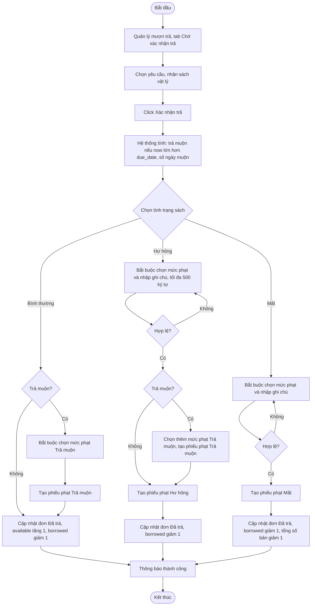

# 2.4.2 Xác Nhận Trả Sách

- **Actor:** Nhân viên thư viện
- **Tiền điều kiện:** Đăng nhập vai trò Librarian; có yêu cầu trả `Chờ xác nhận` (2.4.1); đã nhận sách vật lý
- **Hậu điều kiện:** Đơn mượn thành `Đã trả`; có thể sinh 0 đến 2 phiếu phạt

## Flow

Mọi bước ghi (đổi trạng thái yêu cầu trả, đổi trạng thái đơn, cập nhật kho, tạo phiếu phạt) nằm trong **một transaction**.

## Tác động lên kho

| Tình trạng | available | borrowed | Tổng số bản |
|-----------|-----------|----------|-------------|
| Bình thường | +1 | -1 | giữ nguyên |
| Hư hỏng | giữ nguyên `[Giả định]` | -1 | giữ nguyên, ghi nhận là hư hỏng |
| Mất | giữ nguyên | -1 | -1 |

## Edge cases

| # | Tình huống | Xử lý |
|---|-----------|-------|
| 1 | Yêu cầu đã được nhân viên khác xử lý | Cập nhật có điều kiện theo trạng thái; báo "đã xử lý", tải lại |
| 2 | Hư hỏng hoặc Mất nhưng chưa chọn mức phạt, hoặc thiếu ghi chú | Chặn, hiển thị lỗi field |
| 3 | Ghi chú dài hơn 500 ký tự | Từ chối |
| 4 | Admin chưa cấu hình mức phạt nào | Không thể xác nhận Hư hỏng, Mất hoặc trả muộn; thông báo liên hệ Admin. Trả đúng hạn, bình thường vẫn xác nhận được |
| 5 | Mức phạt bị sửa hoặc xóa sau khi chọn | Phiếu phạt lưu **bản sao số tiền** tại thời điểm tạo |
| 6 | Mất và trả muộn | `[Cần làm rõ]` PRD chỉ nói thêm phiếu "Trả muộn" cho trường hợp Hư hỏng. Đề xuất áp dụng nhất quán: Mất cũng có thể kèm phí muộn |
| 7 | Nhân viên xác nhận trả mà không có yêu cầu của độc giả (trả tại quầy) | PRD không có; `[Cần làm rõ]` |
| 8 | Lỗi giữa chừng | Rollback toàn bộ, đơn giữ nguyên `Đang mượn` |
| 9 | Phiếu phạt vừa tạo và độc giả có đơn khác chờ xác nhận mượn | 2.3.2 kiểm tra lại điều kiện và chặn xác nhận |

## Điểm cần làm rõ

- `[Cần làm rõ]` Sách **Hư hỏng** có quay lại kho cho mượn tiếp không. PRD dashboard (2.7.1) có số "Hư hỏng" riêng, nên giả định không cộng vào available.
- `[Cần làm rõ]` Cách tính số tiền phạt trả muộn: PRD để nhân viên chọn một mức phạt cố định, không nhân theo số ngày muộn.
