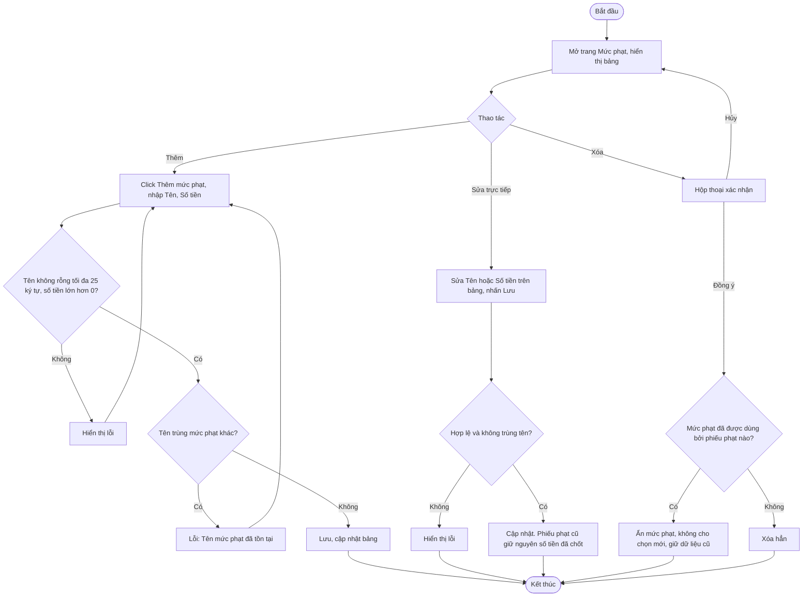

# 2.5.1 Quản Lý Mức Phạt

- **Actor:** Quản lý viên (Admin)
- **Tiền điều kiện:** Đăng nhập vai trò Admin
- **Hậu điều kiện:** Danh mục mức phạt được thêm, sửa hoặc xóa

## Flow

## Edge cases

| # | Tình huống | Xử lý |
|---|-----------|-------|
| 1 | Số tiền 0, âm, chữ, quá nhiều chữ số | Từ chối; `[Giả định]` số nguyên VND, tối đa 9 chữ số |
| 2 | Số tiền thập phân | VND không có phần lẻ, làm tròn hoặc từ chối `[Giả định]` từ chối |
| 3 | Sửa số tiền khi phiếu phạt cũ đang chờ thanh toán | Không ảnh hưởng phiếu cũ (đã lưu bản sao số tiền) |
| 4 | Xóa mức phạt đã dùng | Soft delete (`is_active = false`), không vi phạm khóa ngoại |
| 5 | Xóa hết mức phạt | Cho phép, nhưng 2.4.2 sẽ chặn các trường hợp cần phạt |
| 6 | Librarian truy cập trang | 403; nhân viên chỉ được **chọn** mức phạt ở 2.4.2 |
| 7 | Hai Admin sửa cùng lúc | Khóa lạc quan hoặc ghi đè sau cùng và tải lại bảng |

## Điểm cần làm rõ

- `[Cần làm rõ]` PRD liệt kê validate "Ngày phạt: ngày hợp lệ, mặc định là ngày hiện tại" cho **mức phạt**. Ngày phạt là thuộc tính của **phiếu phạt** khi phát sinh, không phải của mức phạt. Đề xuất bỏ trường này khỏi bảng mức phạt, đưa vào bảng phiếu phạt.
- `[Giả định]` Mức phạt không phân loại (muộn, hư hỏng, mất) trong PRD; đề xuất thêm cột `loại` để lọc khi chọn ở 2.4.2. Cần xác nhận.
