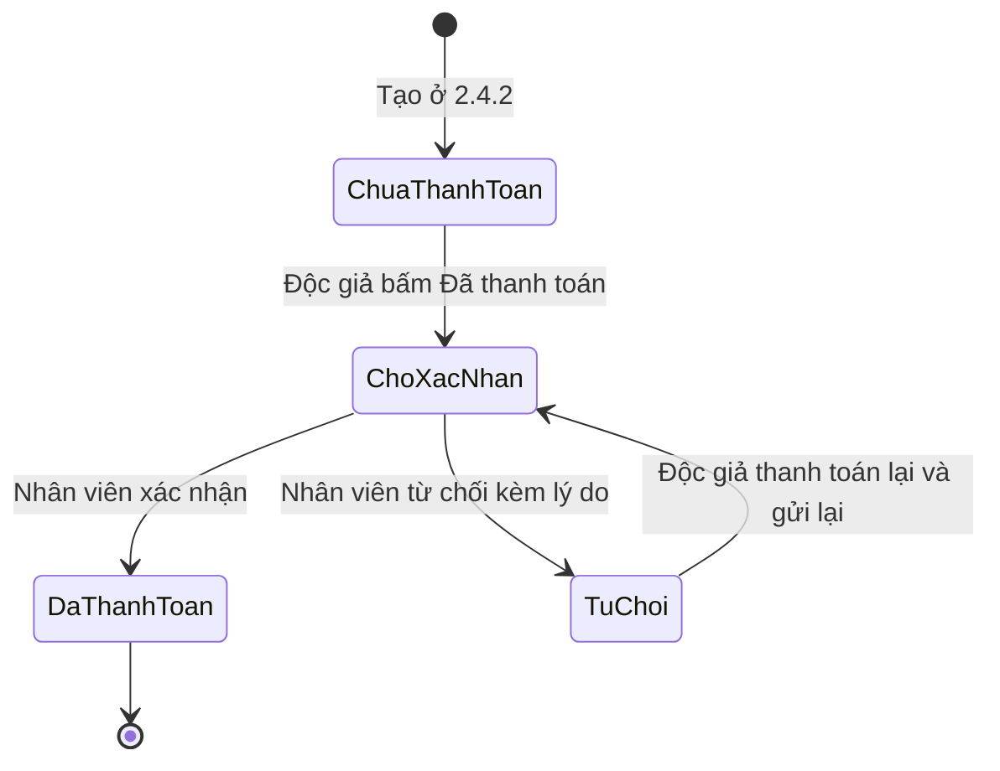
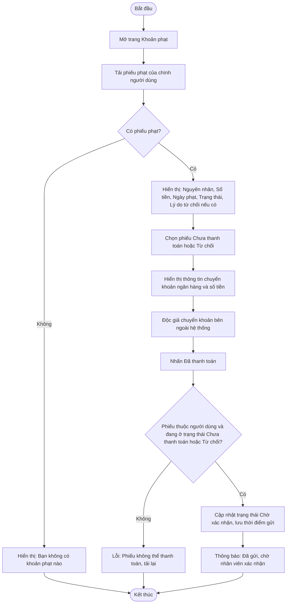

# 2.5.2 Xem và Thanh Toán Khoản Phạt (Độc Giả)

- **Actor:** Độc giả
- **Tiền điều kiện:** Đăng nhập vai trò Reader; có phiếu phạt (từ 2.4.2)
- **Hậu điều kiện:** Phiếu phạt chuyển `Chưa thanh toán` sang `Chờ xác nhận`

## Vòng đời phiếu phạt

## Flow

## Edge cases

| # | Tình huống | Xử lý |
|---|-----------|-------|
| 1 | Bấm Đã thanh toán hai lần | Cập nhật có điều kiện theo trạng thái; lần hai báo lỗi |
| 2 | Phiếu bị nhân viên từ chối | Hiển thị lý do, cho phép gửi lại, trạng thái về `Chờ xác nhận` |
| 3 | Độc giả bấm Đã thanh toán nhưng chưa chuyển khoản | Hệ thống không tự kiểm tra; nhân viên đối chiếu sao kê rồi từ chối nếu không khớp |
| 4 | Nhiều phiếu phạt | Cho phép thanh toán từng phiếu; `[Cần làm rõ]` có gộp một lần chuyển khoản không. Giả định từng phiếu |
| 5 | Nội dung chuyển khoản | Gợi ý nội dung chứa mã phiếu để nhân viên đối chiếu |
| 6 | Xem phiếu của người khác qua id | Lọc theo `user_id` từ token, 404 |
| 7 | Còn phiếu chưa `Đã thanh toán` | Bị chặn mượn mới (2.3.1) |

## Điểm cần làm rõ

- `[Cần làm rõ]` Tích hợp thanh toán: PRD chỉ nói chuyển khoản thủ công. Giả định không có cổng thanh toán tự động.
- `[Cần làm rõ]` Có cho tải ảnh chụp biên lai (Supabase Storage đã nằm trong tech stack) không. Đề xuất: tùy chọn.
