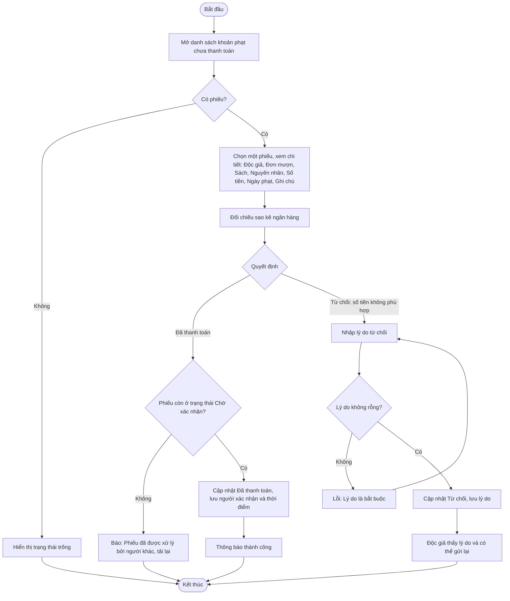

# 2.5.3 Xem và Xác Nhận Thanh Toán Khoản Phạt (Nhân Viên Thư Viện)

- **Actor:** Nhân viên thư viện
- **Tiền điều kiện:** Đăng nhập vai trò Librarian; có phiếu phạt `Chờ xác nhận` (2.5.2)
- **Hậu điều kiện:** Phiếu thành `Đã thanh toán` hoặc `Từ chối` kèm lý do

## Flow

## Edge cases

| # | Tình huống | Xử lý |
|---|-----------|-------|
| 1 | Hai nhân viên cùng xử lý một phiếu | Cập nhật có điều kiện theo trạng thái |
| 2 | Phiếu `Chưa thanh toán` (độc giả chưa bấm gửi) | Nhân viên chỉ thấy để theo dõi; `[Cần làm rõ]` có cho xác nhận hộ khi độc giả nộp tiền mặt tại quầy không. PRD chỉ nêu chuyển khoản |
| 3 | Chuyển thiếu hoặc thừa tiền | Từ chối kèm lý do; phần thừa xử lý ngoài hệ thống |
| 4 | Lý do quá dài | `[Giả định]` tối đa 500 ký tự |
| 5 | Phiếu cuối cùng được xác nhận | Độc giả hết bị chặn mượn (2.3.1) |
| 6 | Reader truy cập trang | 403 |
| 7 | Hủy xác nhận sau khi đã Đã thanh toán | Không hỗ trợ (trạng thái cuối); `[Cần làm rõ]` quy trình sửa sai |

## Điểm cần làm rõ

- `[Cần làm rõ]` PRD ghi "Xem & thanh toán" cho nhân viên nhưng thực chất là xác nhận. Danh sách ban đầu cần bao gồm trạng thái nào (chỉ `Chờ xác nhận` hay cả `Chưa thanh toán`).
