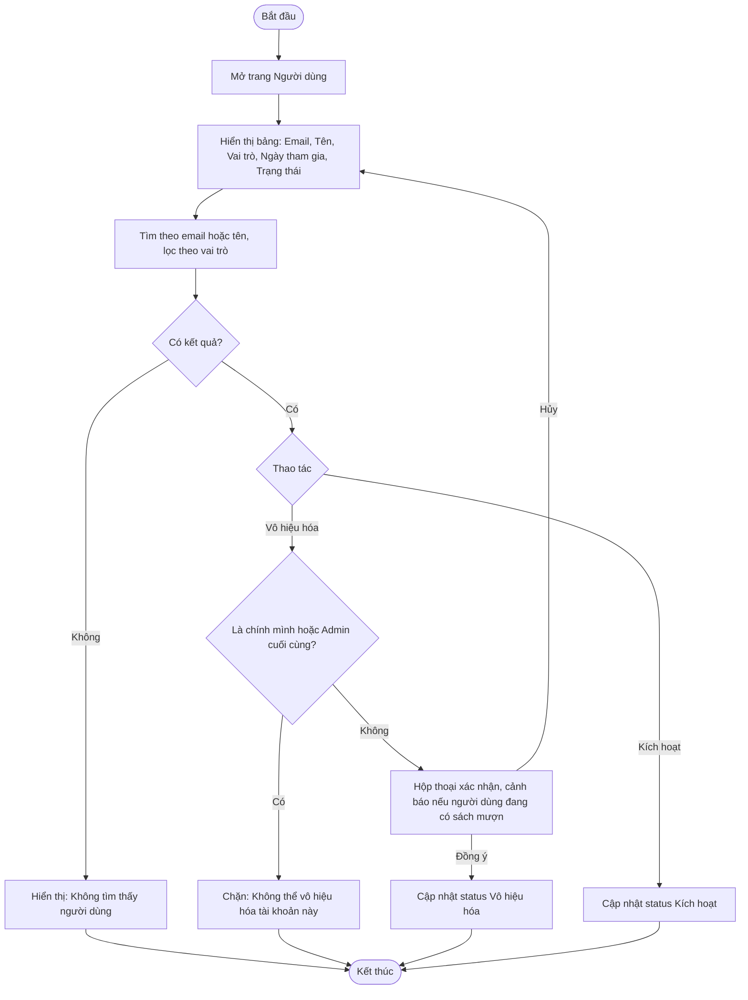

# 2.6.1 Danh Sách Người Dùng

- **Actor:** Quản lý viên (Admin)
- **Tiền điều kiện:** Đăng nhập vai trò Admin
- **Hậu điều kiện:** Trạng thái Kích hoạt hoặc Vô hiệu hóa của tài khoản có thể thay đổi

## Flow

## Edge cases

| # | Tình huống | Xử lý |
|---|-----------|-------|
| 1 | Admin tự vô hiệu hóa chính mình | Chặn, tránh mất quyền truy cập |
| 2 | Vô hiệu hóa Admin cuối cùng đang hoạt động | Chặn |
| 3 | Vô hiệu hóa người dùng đang mượn sách | Cho phép, đơn mượn giữ nguyên và vẫn phải trả; nhân viên vẫn xử lý được trả sách và phiếu phạt. Cảnh báo cho Admin |
| 4 | Người dùng bị vô hiệu hóa khi đang đăng nhập | Request kế tiếp bị chặn (middleware kiểm tra status trong DB) |
| 5 | Kích hoạt tài khoản `Chờ xác nhận` | Cùng thao tác "Kích hoạt" `[Giả định]` |
| 6 | Tìm kiếm có ký tự đặc biệt | Escape wildcard, truy vấn tham số hóa |
| 7 | Danh sách lớn | Phân trang `[Giả định]` 10 hoặc 20 dòng/trang |
| 8 | Librarian truy cập trang | 403 |

## Điểm cần làm rõ

- `[Cần làm rõ]` PRD có hai bộ trạng thái tài khoản: `Chờ xác nhận` (2.1.1) và `Kích hoạt/Vô hiệu hóa` (2.6.1). Đề xuất enum `pending`, `active`, `disabled`.
