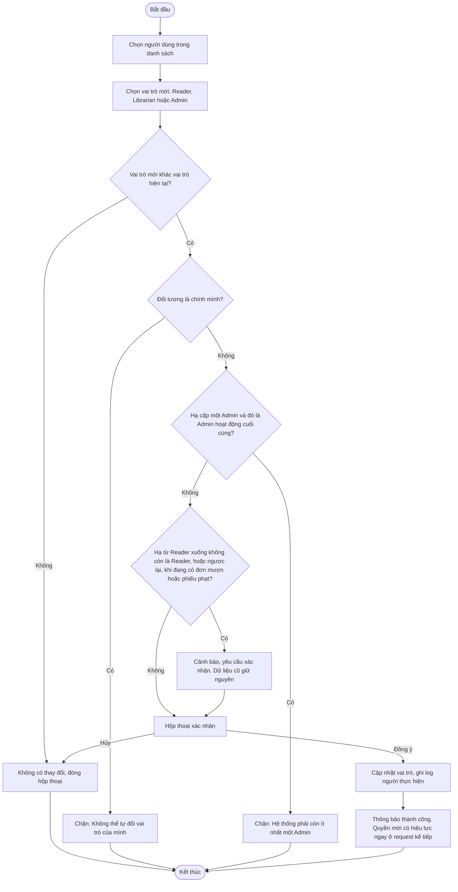

# 2.6.2 Gán Vai Trò

- **Actor:** Quản lý viên (Admin)
- **Tiền điều kiện:** Đăng nhập vai trò Admin; đã có danh sách người dùng (2.6.1)
- **Hậu điều kiện:** Người dùng có vai trò mới `Reader`, `Librarian` hoặc `Admin`

## Flow

## Edge cases

| # | Tình huống | Xử lý |
|---|-----------|-------|
| 1 | Người dùng đang đăng nhập khi bị đổi vai trò | Quyền lấy từ DB mỗi request (xem 2.1.2); UI cập nhật sau khi tải lại hoặc gặp 403 |
| 2 | Hai Admin cùng đổi vai trò một người | Ghi nhận lần sau cùng; kiểm tra "Admin cuối cùng" trong transaction để tránh cả hai cùng hạ cấp lẫn nhau |
| 3 | Gán vai trò cho tài khoản `Vô hiệu hóa` hoặc `Chờ xác nhận` | `[Giả định]` cho phép, nhưng không có hiệu lực cho đến khi kích hoạt |
| 4 | Librarian đang có yêu cầu xử lý dở | Đơn không gắn người xử lý cố định nên không bị kẹt |
| 5 | Vai trò không hợp lệ gửi qua API | Validate theo enum, 400 |
| 6 | Librarian gọi API | 403 |

## Điểm cần làm rõ

- `[Cần làm rõ]` Đổi vai trò Reader thành Librarian có xóa khả năng mượn sách không. Giả định: nhân viên không mượn sách bằng tài khoản nhân viên; dữ liệu mượn cũ vẫn được giữ.

## Quyết định khi triển khai (2026-10-26)

- API `POST /api/users/:id/role` `{ role }`; vai trò đổi ngay ở cột Vai trò của trang Người dùng (2.6.1), qua hộp thoại xác nhận.
- Vai trò mới trùng vai trò hiện tại → 200 `changed: false`, không ghi log (gồm cả edge 2 khi Admin khác đã đổi trước sang cùng vai trò). Đổi sang vai trò khác thì lần sau cùng thắng.
- Edge 2: khóa mọi Admin đang hoạt động (theo id) rồi tới người dùng, cùng thứ tự với 2.6.1; người thực hiện không còn là Admin hoạt động → 403. Hạ Admin hoạt động cuối cùng → 409 `last_admin`; tự đổi → 409 `self`.
- `[Giả định]` Cảnh báo khi người dùng còn đơn đang mượn, đơn chờ duyệt hoặc phiếu phạt chưa Đã thanh toán, với mọi hướng đổi (không chỉ Reader ↔ khác). Dữ liệu cũ giữ nguyên, kể cả đơn chờ duyệt; nhân viên vẫn xử lý được.
- Ghi `audit_logs` action `user.role` với vai trò cũ/mới và người thực hiện.
