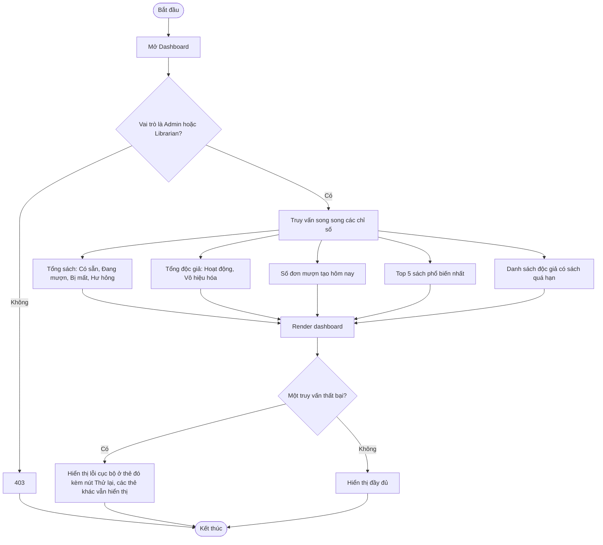

# 2.7.1 Báo Cáo Tổng Quan (Dashboard)

- **Actor:** Quản lý viên, Nhân viên thư viện
- **Tiền điều kiện:** Đăng nhập vai trò Admin hoặc Librarian
- **Hậu điều kiện:** Chỉ xem, không thay đổi dữ liệu

## Flow

## Định nghĩa chỉ số

| Chỉ số | Cách tính `[Giả định]` |
|--------|-----------------------|
| Có sẵn | Tổng `available` của mọi sách chưa xóa |
| Đang mượn | Tổng `borrowed` (đơn Đang mượn và Quá hạn) |
| Bị mất | Số đơn trả có tình trạng Mất |
| Hư hỏng | Số đơn trả có tình trạng Hư hỏng |
| Độc giả hoạt động / vô hiệu hóa | Đếm Reader theo `status`; không tính tài khoản `Chờ xác nhận` |
| Đơn mượn hôm nay | Đơn có `created_at` thuộc ngày hiện tại theo múi giờ `Asia/Ho_Chi_Minh` |
| Top 5 phổ biến | 5 sách có nhiều đơn mượn đã xác nhận nhất; bằng nhau thì theo tên |
| Độc giả nợ quá hạn | Reader có ít nhất một đơn Đang mượn với hạn trả đã qua; hiển thị tên, sách, số ngày muộn |

## Edge cases

| # | Tình huống | Xử lý |
|---|-----------|-------|
| 1 | Hệ thống mới, chưa có dữ liệu | Hiển thị 0 và trạng thái trống, không lỗi chia cho 0 |
| 2 | Ít hơn 5 sách từng được mượn | Hiển thị số sách có thể có |
| 3 | Nhiều độc giả quá hạn | Giới hạn 10 dòng đầu kèm liên kết xem tất cả (báo cáo 2.7.2) |
| 4 | Ranh giới nửa đêm cho "hôm nay" | Tính theo múi giờ cố định, không theo giờ trình duyệt |
| 5 | Dữ liệu cũ trong cache | `[Giả định]` Không cache hoặc cache dưới 1 phút |
| 6 | Reader truy cập | 403 |
| 7 | Sách bị soft delete | Không tính vào tổng sách nhưng vẫn tính vào thống kê mượn |

## Điểm cần làm rõ

- `[Cần làm rõ]` Hai chỉ số "Bị mất" và "Hư hỏng" phụ thuộc vào cách ERD lưu kết quả trả sách (xem 2.4.2).
