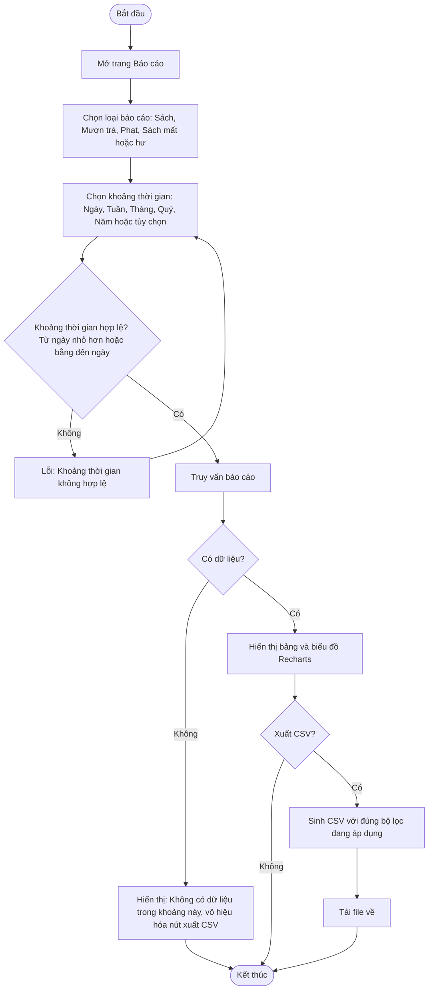

# 2.7.2 Báo Cáo Chi Tiết

- **Actor:** Quản lý viên, Nhân viên thư viện
- **Tiền điều kiện:** Đăng nhập vai trò Admin hoặc Librarian
- **Hậu điều kiện:** Xem hoặc xuất báo cáo CSV, không thay đổi dữ liệu

## Flow

## Nội dung 4 báo cáo `[Giả định]`

| Báo cáo | Nội dung chính |
|---------|---------------|
| Sách | Tổng số sách, số có sẵn, đang mượn, mất, hư hỏng, số lần mượn theo từng sách |
| Mượn trả | Số lượt mượn và trả, gom theo ngày, tháng hoặc quý |
| Phạt | Tổng tiền phạt đã thu, chưa thu, danh sách độc giả nợ phạt hoặc quá hạn |
| Sách mất hoặc hư | Danh sách sách cần thay thế: tên, ISBN, số bản, loại (mất hoặc hư), ngày ghi nhận |

## Edge cases

| # | Tình huống | Xử lý |
|---|-----------|-------|
| 1 | Từ ngày lớn hơn đến ngày | Chặn, báo lỗi |
| 2 | Khoảng thời gian rất dài, nhiều bản ghi | Giới hạn khoảng tối đa hoặc stream CSV; truy vấn gom nhóm ở DB, không tải toàn bộ vào bộ nhớ |
| 3 | CSV mở bằng Excel bị lỗi tiếng Việt | Ghi BOM UTF-8 |
| 4 | Giá trị bắt đầu bằng `=`, `+`, `-`, `@` (tên sách, tên người dùng) | Thêm ký tự `'` đầu ô để chống CSV injection |
| 5 | Giá trị chứa dấu phẩy, xuống dòng, dấu nháy | Bao trong dấu nháy kép và escape |
| 6 | Xuất CSV khác dữ liệu đang xem | CSV dùng đúng tham số lọc hiện tại, truy vấn lại ở server |
| 7 | Librarian xem báo cáo Phạt | `[Giả định]` được xem (PRD cho cả hai vai trò) |
| 8 | Reader truy cập | 403 |
| 9 | Mốc "Tuần" bắt đầu từ thứ Hai hay Chủ nhật | `[Giả định]` thứ Hai |

## Điểm cần làm rõ

- `[Cần làm rõ]` Thuật ngữ "người nợ ngoài hạn" trong báo cáo Phạt nên hiểu là độc giả có phiếu phạt chưa thanh toán hay độc giả có sách quá hạn. Giả định: cả hai, trình bày thành hai cột.
